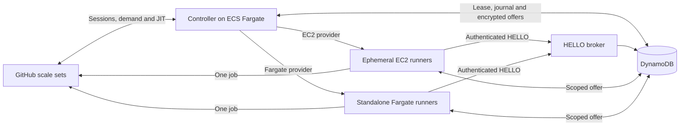

# scaleset-dotnet-aws

[](https://github.com/knightfall/scaleset-dotnet-aws/actions/workflows/ci.yml)
[](https://github.com/knightfall/scaleset-dotnet-aws/actions/workflows/release-candidate.yml)
[](https://github.com/knightfall/scaleset-dotnet-aws/releases)
[](https://scorecard.dev/viewer/?uri=github.com/knightfall/scaleset-dotnet-aws)
[](LICENSE)

A .NET 10 controller for GitHub Actions runner scale sets on AWS. It runs on
ECS Fargate and provisions ephemeral, one-job runners on Direct EC2 instances
or standalone Fargate tasks. Profiles bind GitHub scale sets to independently
configured runner capacity and AWS resources.

The controller is in alpha. The documented target is one AWS account and Region
per controller deployment, with Linux x64 or arm64 runners. Each target needs
its own [AWS and GitHub qualification](docs/emulator-boundaries.md) before use.

## Offline quick start

Try the configuration compiler and controller without AWS or GitHub credentials.
Install the .NET SDK specified in [global.json](global.json), and Node and npm
at the versions in [.node-version](.node-version) and
[cdk/package.json](cdk/package.json). Run these commands from the repository root.

```sh
work_dir=$(mktemp -d)
npm --prefix cdk ci --engine-strict --ignore-scripts
dotnet restore src/Knightfall.ScaleSet.Aws.Controller --locked-mode -m:1
dotnet build src/Knightfall.ScaleSet.Aws.Controller --no-restore -m:1
npm --prefix cdk run config:emit -- ../testdata/config/ec2-only-pinned.yaml "$work_dir/runner-offline.json"
dotnet run --project src/Knightfall.ScaleSet.Aws.Controller --no-build --no-restore -- \
  reconcile --config "$work_dir/runner-offline.json" --dry-run --once
```

Dependency installation may need network access. The report itself runs offline.
The fixture contains example identifiers and no demand source. The compiler
writes a runtime JSON file and prints its SHA-256. The controller prints a
capacity report without inspecting AWS or changing resources. Expect unknown
demand and inventory and zero proposed starts. The example does not model jobs.
For snapshots, replays and AWS inspection, see [local controller use](docs/controller-local.md).

## Architecture



The controller keeps durable ownership and effect records in DynamoDB. Runner
bootstraps register through the IAM-authenticated HELLO broker and consume their
own encrypted just-in-time offers. Runner instances and tasks connect to GitHub
to execute a job. EventBridge and SQS also deliver resource observations to the
controller.

## Run on AWS

1. Choose a Linux x64 or arm64 controller archive from
   [GitHub Releases](https://github.com/knightfall/scaleset-dotnet-aws/releases)
   and [verify its attestation and payloads](docs/releases/VERIFYING.md), or
   [build an archive from source](docs/controller-local.md#build-the-oci-archives).
2. Prepare the [profile bindings](docs/profile-bindings.md), runner AMI or image,
   GitHub credentials and AWS resources. Use the
   [Direct EC2 bootstrap](docs/ec2-runner-bootstrap.md) or
   [Fargate bootstrap](docs/fargate-runner-bootstrap.md) guidance for each profile.
3. Follow the [operator runbook](docs/operator-runbook.md) to qualify the target,
   pin the registry image and deploy. Use the
   [telemetry guide](docs/operator-telemetry.md) for monitoring and troubleshooting.

Fargate runner tasks require workflows that do not need a Docker daemon, Docker
container actions, job or service containers, or privileged operations. Direct
EC2 profiles can run container workloads using a qualified rootless Docker
daemon. Each allowed network and container mode requires qualification. Windows
is outside the shipped runner bootstrap contract. Custom GHES hosts and custom
CA/mTLS transport are not supported by this SDK baseline.

## Build and test

Run the checks with the pinned .NET SDK, Node and npm installed.

```sh
make check
```

Hosted CI runs the same Make targets in three parallel stages for .NET and
lifecycle, CDK and release-helper verification, and integration. The required
`check` status requires success from all three. Lifecycle and integration use
separate pinned MiniStack processes on loopback. Use standard CPython 3.11–3.14
on x64 or arm64 macOS or Linux with compatible wheels. The lock covers macOS and
Linux with glibc 2.17+ or musl 1.2+. Each run installs hash-verified wheels in a
temporary virtual environment. CI runs on Ubuntu x64. Select an interpreter
with `make check MINISTACK_PYTHON=python3.11`.

The standalone `make check-integration` target also exercises the YAML emitter.
Run `make restore-cdk` first to install its pinned dependencies. The
[released SDK baseline](docs/dependency-baseline.md) records package versions
and session-recovery limits. Maintainers can follow the
[release process](docs/releases/PUBLISHING.md) for distributing images.
