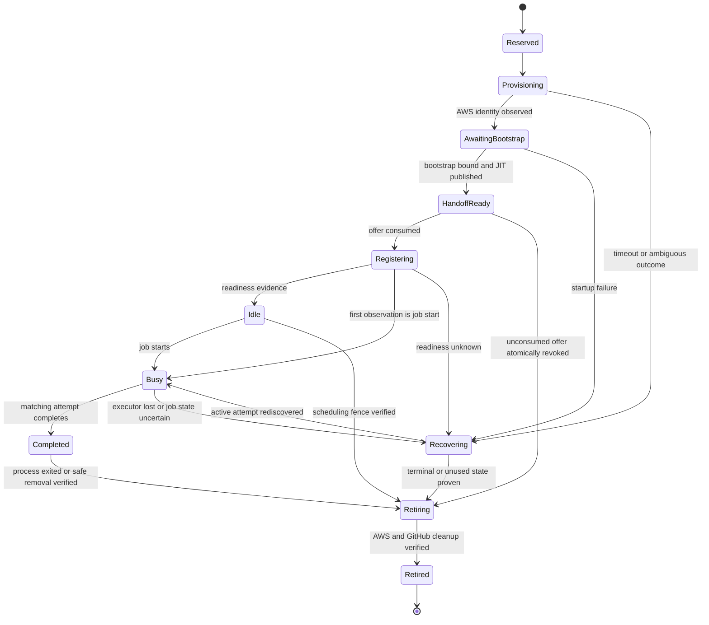

# AWS GitHub Runner Scale Set Controller (.NET 10)

The [approved baseline](https://github.com/knightfall/scaleset-dotnet-aws/pull/1)
defines the architecture and delivery sequence. All 26 implementation tasks
in the [task index](tasks/README.md) are complete. Follow the
[operator runbook](operator-runbook.md) for deployment and recovery, the
[target qualification record](emulator-boundaries.md) for verified scope, and
the [release process](releases/PUBLISHING.md) for distributing controller images.

## 1. API and repository baseline

`scaleset-dotnet-aws` targets `.NET 10` (`net10.0`) with [AGENTS.md](../AGENTS.md) as the repository contract. Pin the published `Knightfall.ScaleSet.Client` and `Knightfall.ScaleSet.Listener` packages to the exact version recorded in the [released dependency baseline](dependency-baseline.md), along with its artifact identities, verification instructions, supported APIs, and qualification limits. Consume the release from NuGet.org with Central Package Management (`Directory.Packages.props`) and committed lock files. The SDK wire baseline tracks `actions/scaleset` at `716908e5`.

| Concern | Inspected API and design implication |
| --- | --- |
| GitHub authentication | `Knightfall.ScaleSet.Client` exposes `ScaleSetClient(GitHubTarget, ScaleSetCredentials, ...)` with mutually exclusive PAT and GitHub App factories (`FromPersonalAccessToken`, `FromGitHubApp` with PKCS#1/PKCS#8 PEM or async JWT signer). GitHub.com and GitHub Enterprise Cloud (`*.ghe.com` and `github.com/enterprises/{enterprise}`) are supported. The AWS configuration uses GitHub App credentials for repository and organization targets and a classic PAT with `manage_runners:enterprise` for enterprise targets. Custom GHES hosts (`scaleset.NET` `#20`) and custom root CA / mTLS (`scaleset.NET` `#21`) are **deferred** and rejected cleanly at validation until implemented upstream. |
| GitHub identity and provisioning | `ScaleSetClient` exposes `GetRunnerGroupByNameAsync`, `FindScaleSetAsync`, `ListScaleSetsAsync`, `GetScaleSetAsync`, `CreateScaleSetAsync`, `UpdateScaleSetAsync`, `GenerateJitConfigAsync`, `GetRunnerAsync`, `FindRunnerByNameAsync`, and `RemoveRunnerAsync`. Required admin/JIT calls reject JSON `null` and trailing garbage via `ScaleSetApiException`. Existence via `GetRunnerAsync` proves identity only, not online/idle readiness; `RemoveRunnerAsync` preserves domain error classification (such as job-still-running), whose scheduling-fence race is modeled in the local GitHub simulator (`T22`) while keeping automated idle termination disabled by default. |
| GitHub sessions and listener extensibility | `CreateMessageSessionAsync` returns `MessageSessionClient` (`GetMessageAsync`, `AcquireJobsAsync`, `DeleteMessageAsync`, `CloseAsync`). The released `ScaleSetListenerPump.StepAsync` composes checkpoint storage, a replay-safe delivery handler, and per-operation authorization; T09 supplies these adapters and session supervision. Queue-token refresh preserves the session GUID. `ScaleSetClient.DeleteMessageSessionAsync` supports retirement by journaled scale-set ID and exact session GUID after process loss; ambiguous outcomes remain unresolved. See the [released dependency contract](dependency-baseline.md). |
| Retry and rate-limit control | `ScaleSetClient` provides `ScaleSetRetryOptions` (`MaxElapsed`, `Deadline`, `OnRateLimit`, `ScaleSetRateLimitPolicies`), `ScaleSetRateLimitException`, `ScaleSetMaxElapsedExceededException`, and per-call `ScaleSetRequestRetry` scopes. For non-idempotent mutations (`GenerateJitConfigAsync`, `CreateScaleSetAsync`, `CreateMessageSessionAsync`), configure `ScaleSetRequestRetry` with a single wire attempt so the DynamoDB journal owns ambiguity resolution and retries. |
| Direct EC2 runner compute | Use AWS SDK for .NET v4 `Amazon.EC2` (`RunInstances` with `MinCount=1, MaxCount=1`, `TerminateInstances`, `DescribeInstances`, `DescribeLaunchTemplateVersions`, `DescribeImages`, `DescribeSubnets`, `DescribeSecurityGroups`, `CreateTags`) and `Amazon.IdentityManagement` (`GetInstanceProfile`, `GetRole`). Support both pinned numeric Launch Template versions and safely preflight-resolved `$Latest` / `$Default` aliases pinned into every launch intent. Pin subnet/AZ per `ClientToken` because EC2 idempotency is AZ-scoped. |
| Amazon ECS Fargate runner compute | Use AWS SDK for .NET v4 `Amazon.ECS` (`RunTask` with `count=1`, revision-qualified `TaskDefinition`, `LaunchType=FARGATE`, `awsvpc` networking, durable `ClientToken`, `StartedBy=ss-<32hex>`, and `Tags`; `ListTasks`, `DescribeTasks`, `DescribeClusters`, `DescribeTaskDefinition`, `ListAccountSettings`, `StopTask`). Always inspect both `Tasks` and `Failures` on HTTP 200 and handle eventual consistency. |
| DynamoDB and supporting AWS services | Use AWS SDK for .NET v4 `Amazon.DynamoDBv2` (`TransactWriteItems`, strongly consistent `GetItem`/`Query`, conditional `PutItem`/`DeleteItem` with `ReturnValues=ALL_OLD`), `Amazon.SecretsManager`, `Amazon.S3`, `Amazon.SQS`, and `Amazon.SecurityToken`. The lifecycle store sets `TransactWriteItemsRequest.ClientRequestToken` to the durable transition ID. Journal-owned AWS clients disable error retries and stale-connection retries. |
| Local AWS and GitHub emulation | CI starts pinned MiniStack on dynamically allocated loopback endpoints, plus a GitHub Scale Set simulator and loopback IMDSv2 and ECS Task Metadata v4 stubs. The integration harness also starts a separate IAM-enforcing MiniStack endpoint. See the [test and target boundaries](emulator-boundaries.md). |

### Offline SDK contract tests

The [SDK contract suite](../tests/Knightfall.ScaleSet.Aws.SdkContract.Tests/) tests the published Client/Listener baseline and pinned AWS SDK for .NET v4 packages using fake HTTP handlers, deterministic `TimeProvider` instances, and recorded wire fixtures:

- Verify `GitHubTarget` / `ScaleSetCredentials` rejection of enterprise Apps, GHES hosts, and `caBundlePath`.
- Verify single-attempt `ScaleSetRequestRetry` budgets on JIT/scale-set/session creation, exact-session retirement, and conservative pump acknowledgement when a fake server commits then drops the HTTP response, alongside `ScaleSetRateLimitException` metadata extraction.
- Verify AWS SDK for .NET v4 serialization, `MaxErrorRetry = 0` per-client/per-request behavior for `RunInstances`, `TerminateInstances`, `RunTask`, and `StopTask`, `TransactWriteItems` `ClientRequestToken` emission, `DeleteItem(ALL_OLD)` error mapping, and `DescribeLaunchTemplateVersions` / `DescribeTasks` pagination and partial-failure structures.
- Re-run `SdkContract.Tests` whenever upgrading `Knightfall.ScaleSet.*` or `AWSSDK.*` packages.

## 2. Architecture and ownership

One ECS Fargate `.NET 10` controller service runs independent supervised listener and reconciliation lanes per enabled runner profile. Each profile binds one homogeneous GitHub scale set and one AWS runner backend (`ec2` or `fargate`). One shared DynamoDB table holds ownership leases, catalog bindings, admission/delivery state, operation intents, executor observations, and encrypted JIT offers. GitHub supplies job demand; AWS inventory and EventBridge/SQS notifications supply resource observations. Use one AWS account and Region per controller deployment initially.

Out of scope for v1: local Docker runner provisioning (`Knightfall.ScaleSet.Providers.Docker`), non-Fargate controller hosting (VM-hosted, standalone non-ECS hosts, AWS Lambda), Auto Scaling Group runner adoption (optional future provider), custom GHES hosts (`scaleset.NET` `#20`), and custom root CA / mTLS (`scaleset.NET` `#21`).

```mermaid
flowchart LR
    YAML["Environment YAML"] --> CDK["TypeScript CDK compiler and stack"]
    CDK --> Config["Digest-pinned S3 runtime JSON"]
    Config --> Host
    subgraph Host["One .NET 10 controller on ECS Fargate"]
        direction TB
        Listeners["Supervised GitHub listeners"]
        Reconcile["Capacity planner and per-profile reconcilers"]
        Listeners --> Reconcile
        Reconcile --> EC2["Direct EC2 adapter when enabled"]
        Reconcile --> ECS["Fargate adapter when enabled"]
    end
    GitHub["GitHub scale sets"] <-->|"Sessions, demand and JIT"| Listeners
    Host <-->|"Lease, catalog, intents and encrypted handoff"| Table["Shared DynamoDB table"]
    EC2 --> Instances["Ephemeral EC2 instances"]
    ECS --> Tasks["Standalone Fargate runner tasks"]
    Instances --> Bootstrap["Knightfall.ScaleSet.Aws.RunnerBootstrap"]
    Tasks --> Bootstrap
    Bootstrap -->|"Authenticated HELLO"| Broker["HELLO broker"]
    Broker --> Table
    Bootstrap <-->|"Item-scoped offer consumption"| Table
    Bootstrap -->|"Ephemeral runner, one job"| GitHub
    Instances --> Events["EventBridge and SQS"]
    Tasks --> Events
    Events --> Reconcile
    Secrets["Secrets Manager"] -->|"GitHub App credentials or enterprise PAT"| Host
```



The solution enforces compile-time boundaries across `Knightfall.ScaleSet.Aws.slnx`:

- `Knightfall.ScaleSet.Aws.Core`: configuration/runtime JSON schema rules, capacity planner, dry-run report engine, lifecycle classifier, and provider-neutral contracts (zero references to `AWSSDK.*` or `Knightfall.ScaleSet.*`).
- `Knightfall.ScaleSet.Aws.DynamoDb`: single-table transactions, active-op index, bounded rebuild, leases, admission/delivery ledger, and handoff records.
- `Knightfall.ScaleSet.Aws.GitHub`: Secrets Manager credential loading/rotation, `Knightfall.ScaleSet.Client` adapter, `Knightfall.ScaleSet.Listener` bridge, and shared per-credential cooldown supervisor.
- `Knightfall.ScaleSet.Aws.Providers.Ec2` and `Knightfall.ScaleSet.Aws.Providers.Fargate`: independent provider assemblies initialized only when active or draining profiles require them.
- `Knightfall.ScaleSet.Aws.Handoff`: `.NET 10` BCL cryptographic envelope (`ECDH P-256 + HKDF-SHA256 + AES-256-GCM`) and bootstrap protocol DTOs shared between controller and runner bootstrap.
- `Knightfall.ScaleSet.Aws.Controller`: CLI/host wiring, `/healthz` & `/readyz`, Serilog + OpenTelemetry OTLP export, and native OCI container build (`dotnet publish /t:PublishContainer`, no local Docker daemon needed).
- `Knightfall.ScaleSet.Aws.RunnerBootstrap`: standalone minimal binary deployed inside approved EC2 AMIs and Fargate runner images (no GitHub admin, Secrets Manager, or compute-provisioning dependencies).

| Profile purpose | Supported execution and routing |
| --- | --- |
| `copilot-cloud-agent` | Dedicated runner group and scale set with a unique selector. Start with Ubuntu x64 on Direct EC2, restricted to approved repositories. Any OS/firewall expansion requires its own pinned Launch Template/AMI and operator validation on the target repository/runner group. Use only for Copilot cloud agent. [Cloud agent runner configuration](https://docs.github.com/en/copilot/how-tos/administer-copilot/manage-for-organization/configure-runner-for-coding-agent) |
| `fargate-compatible` | One standalone Fargate task per Linux x64 or arm64 runner. Workflows must run without a Docker daemon, Docker container actions, job/service containers, or privileged operations. |
| `ec2-general` | Separate Direct EC2 profiles and Launch Templates for Linux x64 or arm64 workloads. Docker and service-container workflows require a qualified rootless Docker daemon and approved networking and container modes. Windows x64 can be expressed in the configuration but is outside the shipped bootstrap and qualification boundary. Keep workload privileges inside the one-job instance boundary. |

## 3. Configuration contract

Keep canonical authored YAML under `cdk/config/*.yaml`, validated against versioned JSON Schemas in `cdk/config/schema/` (`controller-config-v1alpha1.json` and `controller-runtime-v1alpha1.json`). CDK parses YAML rejecting duplicate keys, aliases, merge keys, custom tags, non-string keys, and multi-document input. The `.NET 10` loader (`System.Text.Json` with strict unknown/duplicate key rejection) verifies the runtime schema independently and enforces identical semantic rules before opening any SDK client. Shared positive and negative fixtures in `testdata/config/` guarantee TypeScript/.NET parity.

| YAML path | Proposed v1 contract |
| --- | --- |
| `apiVersion`, `kind`, `metadata.name` | Require `scaleset-aws/v1alpha1`, `RunnerController`, and a stable environment name (identity includes account, Region, and name). |
| `spec.aws` | Require account ID and Region. Named network entries in `spec.networks` supply existing `vpcId`, `subnets[]` (`id`, `az`), and `securityGroupIds`. |
| `spec.mode`, `spec.dryRun` | `mode` defaults to `dry-run`. Set `spec.mode: active` in the reviewed YAML after [operator qualification](operator-runbook.md#preflight-and-apply). It selects active IAM grants through the protected deploy. `dryRun.demand` defaults to `none`, or selects a local file or versioned S3 snapshot with SHA-256 digest. `dryRun.inspectAws` defaults to `false` and permits AWS inventory only when demand is `none`. |
| `spec.controller` | Require `image` pinned by ECR `@sha256:...` digest and `hosting` (`type: ecs-fargate`, `network`, `cluster`, `cpuArchitecture`, `cpu`, `memoryMiB`). |
| `spec.tracking.table` | `create` (derives `<metadata.name>-runner-lifecycle`) or `import` (requires `name` and schema/PITR/TTL/encryption preflight). |
| `spec.ecsClusters` | Required when controller hosting (`ecs-fargate`) or any Fargate runner profile references a cluster. `import` takes `arn`; `create` declares `name`. Deduplicated if host and runners share a cluster. |
| `spec.github` | Named connections with `scopeURL` (GitHub.com or `*.ghe.com`) and `auth` union: `github-app` (`secretArn`, org/repo only) or `enterprise-pat` (`secretArn`, `/enterprises/<slug>` only). Reject GHES URLs and custom CA fields cleanly in v1. Profile mapping sets `connection`, `runnerGroup`, `scaleSet`, optional pinned `scaleSetId`, `labels`, and `registration` (`existing` or `create-if-missing`). |
| `spec.profiles[]` | At least one profile, with at least one `active` or `draining`. Immutable `id`, `state` (`active`, `draining`, or `disabled`), `purpose`, `platform` (`os`, `arch`), `capacity` (`idleReserve`, `maxRunners`, `startupTimeoutSeconds`), `github`, and `provisioner`. |
| `profiles[].provisioner` | `ec2`: `launchTemplateId`, `launchTemplateVersion` tagged union (`{ type: pinned, version: "<numeric>" }` or `{ type: alias, name: "$Latest" \| "$Default" }`), `network`, `instanceType` (optional override validated against template), `instanceProfileArn`, `bootstrapRoleArn`, `bootstrapProtocol: v1`, `tenancy`/`subnetStrategy`. `fargate`: `cluster`, `network`, revision-pinned `taskDefinitionArn`, `runnerContainer`, `bootstrapRoleArn`, `executionRoleArn`, `bootstrapProtocol: v1`. Reject fields from the other variant. |

Require disjoint managed labels within each GitHub scope, each label list containing its scale set name, and one active/draining profile per resolved GitHub host/scope/group/scale-set identity. CDK emits a deterministic canonical runtime JSON artifact (independent of YAML comments and key order), prints its SHA-256 digest, publishes it as a versioned S3 asset, and pins exact S3 URI + version ID + SHA-256 + monotonic `--generation` into the ECS controller task launch arguments.

```sh
runtime_sha=$(npm --prefix cdk --silent run config:emit -- ../testdata/config/ec2-only-latest.yaml /tmp/runner-runtime.json)
dotnet run --project src/Knightfall.ScaleSet.Aws.Controller -- config verify --file /tmp/runner-runtime.json --sha256 "$runtime_sha"
```

### Direct EC2 example using `$Latest` Launch Template safe resolution

```yaml
apiVersion: scaleset-aws/v1alpha1
kind: RunnerController
metadata:
  name: engineering-dev
spec:
  aws:
    account: '111122223333'
    region: ap-southeast-2
  mode: dry-run
  dryRun:
    demand:
      type: snapshot
      path: /input/demand.json
    inspectAws: true
  controller:
    image: '111122223333.dkr.ecr.ap-southeast-2.amazonaws.com/scaleset-dotnet-controller@sha256:0123456789abcdef0123456789abcdef0123456789abcdef0123456789abcdef'
    hosting:
      type: ecs-fargate
      network: controller-private
      cluster: control-plane
      cpuArchitecture: arm64
      cpu: 512
      memoryMiB: 1024
  tracking:
    table:
      type: create
  networks:
    controller-private:
      vpcId: vpc-0123456789abcdef0
      subnets:
        - { id: subnet-0123456789abcdef0, az: ap-southeast-2a }
        - { id: subnet-0123456789abcdef1, az: ap-southeast-2b }
      securityGroupIds: [sg-0123456789abcdef0]
    runner-private:
      vpcId: vpc-0123456789abcdef0
      subnets:
        - { id: subnet-0123456789abcdef2, az: ap-southeast-2a }
        - { id: subnet-0123456789abcdef3, az: ap-southeast-2b }
      securityGroupIds: [sg-0123456789abcdef1]
  ecsClusters:
    control-plane:
      type: create
      name: engineering-dev-controller
  github:
    engineering:
      scopeURL: https://github.com/example-engineering
      auth:
        type: github-app
        secretArn: arn:aws:secretsmanager:ap-southeast-2:111122223333:secret:github-app-engineering-a1b2c3
  profiles:
    - id: linux-ec2-docker
      state: active
      purpose: ec2-general
      platform: { os: linux, arch: x64 }
      capacity: { idleReserve: 0, maxRunners: 12, startupTimeoutSeconds: 600 }
      github:
        connection: engineering
        runnerGroup: Linux-EC2
        scaleSet: linux-ec2-docker
        labels: [linux-ec2-docker]
        registration: existing
      provisioner:
        type: ec2
        launchTemplateId: lt-0123456789abcdef0
        launchTemplateVersion:
          type: alias
          name: $Latest
        network: runner-private
        instanceProfileArn: arn:aws:iam::111122223333:instance-profile/runner-linux-bootstrap
        bootstrapRoleArn: arn:aws:iam::111122223333:role/runner-linux-bootstrap
        bootstrapProtocol: v1
```

### Fargate-only example expressed as a change to the base

Keep `aws`, `mode`, `tracking`, `github`, `controller`, and `networks` from the base, add or select the runner `ecsClusters` entry, and replace `profiles`:

```yaml
ecsClusters:
  control-plane:
    type: import
    arn: arn:aws:ecs:ap-southeast-2:111122223333:cluster/engineering
profiles:
  - id: linux-shell
    state: active
    purpose: fargate-compatible
    platform: { os: linux, arch: arm64 }
    capacity: { idleReserve: 0, maxRunners: 24, startupTimeoutSeconds: 600 }
    github:
      connection: engineering
      runnerGroup: No-Docker
      scaleSet: linux-shell
      labels: [linux-shell]
      registration: create-if-missing
    provisioner:
      type: fargate
      cluster: control-plane
      network: runner-private
      taskDefinitionArn: 'arn:aws:ecs:ap-southeast-2:111122223333:task-definition/linux-shell-runner:7'
      runnerContainer: runner
      bootstrapRoleArn: arn:aws:iam::111122223333:role/fargate-runner-bootstrap
      executionRoleArn: arn:aws:iam::111122223333:role/fargate-runner-execution
      bootstrapProtocol: v1
```

### Enterprise PAT connection example

```yaml
corporate:
  scopeURL: https://github.com/enterprises/example-corporate
  auth:
    type: enterprise-pat
    secretArn: arn:aws:secretsmanager:ap-southeast-2:111122223333:secret:github-enterprise-pat-a1b2c3
```

`draining` keeps permissions and bindings, stops acquiring new jobs, advertises `0` capacity where verified, and stops launching new runners. Existing work and cleanup continue. Two separated authoritative passes must confirm zero assigned/busy/uncertain executors, zero pending deliveries/reservations/handoffs, zero unfinished effects, and a durable session closure hold. Removal/disablement requires passing the runtime retirement preflight gate (verified against MiniStack DynamoDB in `T25`) before CDK removes IAM or EventBridge bindings.

## 4. CDK composition and deployment ownership

The standalone TypeScript CDK v2 app lives under `cdk/` with offline synthesis (`cdk synth --strict --no-lookups`), stable order-independent logical IDs, and non-destructive imports of VPCs, subnets, security groups, Launch Templates, ECS task definitions, and imported tables/clusters.

| Selector | CDK creates or configures | Existing dependencies |
| --- | --- | --- |
| All environments | Retained encrypted DynamoDB table with `PK`/`SK`, `due` `KEYS_ONLY` GSI, TTL (`expiresAt`), and PITR when `create`, or reference when `import`. Versioned S3 runtime config asset and retained 30-day log groups for the ECS controller, runtime artifact functions, and provisioned HELLO brokers. Secrets Manager references are active-only. | ECR controller image digest, GitHub secret ARNs, imported table settings, and operator-owned alarms. |
| Controller host (`ecs-fargate`) | Controller ECS task definition, task/execution IAM roles, 1-replica ECS Fargate service (`minHealthyPercent: 0`, `maxHealthyPercent: 100`), circuit breaker, read-only rootfs, ECS Exec disabled, `stopTimeout: 90s`, and `healthcheck` probe. Scoped `ecs:DescribeTasks` on the controller cluster to verify prior controller task termination during takeover. | Selected VPC/subnets/security groups and imported or created controller cluster. |
| Active or draining `ec2` profiles | Scoped EC2 EventBridge/SQS notifications, exact compute and pass-role permissions, IAM-authenticated HELLO registration, one-time `OFFER#` consumption, and an EC2-only `STATUS#` grant for qualified hosts. | Imported Launch Template, subnets/security groups, and owner-prepared AMI/bootstrap installation. |
| Active or draining `fargate` profiles | Scoped ECS EventBridge/SQS notifications, exact task and pass-role permissions, IAM-authenticated HELLO registration, and one-time `OFFER#` consumption. | Imported revision-pinned task definition, roles, network, and selected cluster. |
| `ecsClusters` entries | One `AWS::ECS::Cluster` per distinct referenced `create` entry (reused if shared by host and runners); reference only for `import`. | VPC/subnets placed on task launches. |

Native EC2 state-change notifications carry an instance ID, state, and resource ARN. Scope the rule by account, Region, and event type. Match ownership tags after paginated `DescribeInstances`, and verify the pinned subnet and AZ when resolving a launch. [EC2 state-change notification format](https://docs.aws.amazon.com/AWSEC2/latest/UserGuide/monitoring-instance-state-changes.html)

Capability predicates remain strictly independent: an EC2-only environment creates controller-host ECS resources and contains **zero** runner `ecs:RunTask` or `ecs:StopTask` grants and **zero** runner ECS EventBridge rules; a Fargate-only environment contains **zero** `ec2:RunInstances` or `ec2:TerminateInstances` grants and **zero** EC2 state-change rules; dry-run omits all mutating IAM grants, SQS consumers, and secret-value reads.

## 5. Listener and reconciliation semantics

1. Acquire the environment ownership lease in DynamoDB, record writer protocol lineage, advance any checkpointed `EFFECT-REBUILD`, claim profile mappings, and reconcile prior inventory/effects before enabling admissions. Run one supervised lane per resolved scale set and serialize mutators per profile.
2. Create an owned session and ingest initial statistics through `ScaleSetListenerPump.StepAsync`. The T09 store, handler, and policy adapters preserve the scope/set/session checkpoint identity, authorize every operation, and recompute admission after long polls and during replay. Pending work takes precedence over polling.
3. Persist sanitized `MSG#<session>#<id>` inbox receipts before handling. For `JobAvailable`, reserve distinct request IDs against the admission ledger before calling `AcquireJobsAsync`. Keep accepted and uncertain requests reserved across polls, restarts, and replays; never release a reservation solely from an aggregate `TotalAssignedJobs` increase (keep conservative mode active unless target request-to-statistics ordering is explicitly verified; simulator-tested in T22).
4. Plan `target = min(effectiveMax, TotalAssignedJobs + effectiveIdleReserve)` (`0` reserve when `draining`), and deficit `max(0, target - eligibleServing - crediblePending)`. Compute `OutsideAssigned` conservatively by subtracting only occupied/unknown slots not proved inside the current `TotalAssignedJobs` sample.
5. Treat empty polls as stale-sample holdovers under a bounded freshness threshold; pause demand-driven launches when stale demand exceeds the freshness limit rather than converting missing demand to zero.
6. Persist immutable nonsecret request parameters and SHA-256 digest before every mutating call. Enforce single-attempt `ScaleSetRequestRetry` scopes on non-idempotent GitHub writes (`GenerateJitConfigAsync`, `CreateScaleSetAsync`, `CreateMessageSessionAsync`) and `MaxErrorRetry = 0` on AWS writes where the DynamoDB journal owns recovery.

After controller process loss, fence the previous owner and journal exact-session retirement via `DeleteMessageSessionAsync`. Only confirmed retirement and reconciled admission conditions permit a fresh session. Preserve old unresolved checkpoints/reservations; a replacement receives a new key and no prior cursor. `RecoveryRequired`, lost close responses, and isolated expiration/404 responses remain conservative holds under the [qualification boundary](dependency-baseline.md#session-recovery-and-qualification-boundary).

### Lifecycle and retirement



Persist executor resource observations and authenticated runner-process observations orthogonally with local timestamps and sanitized evidence references. Irreversible termination (`terminated` / `STOPPED`) and one-job process exit stay terminal; late conflicting live evidence locks the allocation in `Recovering`. Automatic reclamation of connected idle runners stays disabled by default (conservative fail-closed behavior), with the `RemoveRunnerAsync` race modeled and tested in the T22 simulator.

### Direct EC2 adapter

- **Preflight & Launch Template version resolution**: Supports `{ type: pinned, version: "<numeric>" }` and `{ type: alias, name: "$Latest" \| "$Default" }`. For alias mode, preflight calls `DescribeLaunchTemplateVersions` to resolve the current numeric version (e.g. `12`) and validates every security/bootstrap invariant on that resolved version: matching platform/AMI (`DescribeImages`), IMDSv2 enforced (`HttpTokens = required`), encrypted root EBS volume, matching `instanceProfileArn` -> `GetInstanceProfile` -> `GetRole` against `bootstrapRoleArn`, valid private subnet/security-group alignment, and approved bootstrap protocol tag/contract. Never pass `$Latest` or `$Default` directly into `RunInstances`; every recorded launch intent and allocation pins the **resolved numeric version**. If a new `$Latest` push violates preflight invariants, freeze new launches for that profile while already-running allocations continue under their recorded provenance.
- **Scale-out & zonal idempotency**: Launch 1 ephemeral runner per intent via `ec2:RunInstances` (`MinCount=1, MaxCount=1`, `LaunchTemplate = { LaunchTemplateId, Version = resolvedNumericVersion }`, single explicit `SubnetId`, `SecurityGroupIds`, ownership tags, and deterministic `ClientToken`) with `MaxErrorRetry = 0`. Because EC2 `ClientToken` is AZ-scoped, pin `(subnetId, resolvedNumericVersion, clientToken)` in the immutable intent before send and never reuse that token in another AZ; on `InsufficientInstanceCapacity`, settle that intent as definitively rejected and open a fresh intent in another eligible subnet/AZ.
- **Scale-in & cleanup**: Only terminate exact owned instances after T10 authorization via `ec2:TerminateInstances` (`MaxErrorRetry = 0`). Observe terminal `terminated` state independently from `shutting-down`, GitHub job completion, and GitHub runner registration cleanup.

### Fargate adapter

- **Preflight**: Verify canonical cluster ARN, revision-pinned `taskDefinitionArn`, `FARGATE`, `awsvpc`, runtime platform, CPU/memory, task/execution roles (`GetRole`), single essential `runnerContainer` (no sidecars, no privileged mode, no ECS Exec, approved image digest), `taskLongArnFormat` (`ListAccountSettings`), and conservative headroom from free subnet IPs plus operator-verified vCPU quota minus in-flight launches without double-counting attached ENIs.
- **Launch & cleanup**: `RunTask` with `count=1`, `startedBy = ss-<32hex>`, stable `clientToken` (max 64 ASCII chars), and ownership tags (`MaxErrorRetry = 0`). Keep a 50-minute conservative replay cutoff from earliest possible first send (`< 1h` ECS token minimum). Reconcile `ListTasks(startedBy=...)`, `DescribeTasks`, and ECS Task State Change events; treat `STOPPED` as resource death only while reconciling GitHub job/registration state independently.

## 6. DynamoDB, recovery and orphan policy

Use one on-demand encrypted table with PITR, string `PK`/`SK`, and a `due` `KEYS_ONLY` GSI (`dueShard` / `dueAtMillis` across 8 deployment shards as a wake-up hint only). Numeric `expiresAt` covers bounded bootstrap records and settled inbox/job/acquisition history. Active ownership, unsettled effects, and durable fences remain separate from TTL-based cleanup.

| PK | SK | Durable contents and access |
| --- | --- | --- |
| `ENV#<deployment>` | `LEASE`, `PROFILE#<id>` | Renewable lease (`epoch`, `ownerTaskArn`, `writerProtocol`, `previousOwnerTaskArn`, `validUntil`), applied generation, catalog bindings, and retired tombstones. Strong reads. |
| `CLAIM#<canonical-remote-id>` | `OWNER` | Unique ownership fence for GitHub scope/group/set name, resolved set ID, or allocated EC2/ECS resource ID. |
| `PROFILE#<deployment>#<profile>` | `SESSION`, `DEMAND`, `ADMISSION`, `EFFECTS`, `EFFECT-REBUILD`, `ACTIVE-OP#<gen>#<intent>`, `CHECKPOINT#<session>`, `MSG#<session>#<id>`, `ACQUIRE#<request>`, `JOB#<attempt>`, `RUNNER#<allocation>`, `RUNNER-ID#<runner-id>`, `OP#<intent>` | Session ownership/closure journal; per-session Listener checkpoint with exact scope/set/session identity, revision, transition ID, original observation, cursor and pending phase; demand freshness, admission reservations, transactional unfinished-effect count, bounded rebuild checkpoint (32 rows/page, 2 pages/pass), active-only index markers, deduplicated messages/jobs, immutable allocation provenance, and nonsecret effect envelopes. |
| `HELLO#BROKER#<aws:userid>`, `OFFER#<aws:userid>`, `STATUS#<aws:userid>` | `BOOTSTRAP` | The authenticated broker alone creates the HELLO record and sets a one-hour TTL. Exact retries retain the original expiry. The controller rejects an expired HELLO before asynchronous DynamoDB removal. Each runner consumes its exact offer. Qualified EC2 supervisors can publish scoped STATUS. |

Maintain `ACTIVE-OP#<gen>#<intent>` and `EFFECTS` atomically in the same revision-checked, lease-fenced `TransactWriteItems` call as `OP#<intent>`. On controller takeover after unclean loss, the successor remains in read-only recovery until it confirms via `ecs:DescribeTasks` on the controller cluster that the prior `ownerTaskArn` reached `STOPPED`, validates host clock-skew margin against the lease deadline, advances any `EFFECT-REBUILD`, and settles all ambiguous `executing`/`uncertain` effects.

## 7. Secure bootstrap, IAM and operations

| Principal | Allowed access |
| --- | --- |
| Active controller (ECS task role) | S3 runtime config read, DynamoDB table/index operations, selected SQS receive/delete, `secretsmanager:GetSecretValue` for active GitHub secret ARNs + KMS decrypt, controller-cluster `ecs:DescribeTasks` for fencing, and strictly enabled backend rights (`ec2:RunInstances`/`TerminateInstances`/`CreateTags` + LT/network/IAM reads for `ec2`; `ecs:RunTask`/`StopTask`/`TagResource` + cluster/task-def/network/IAM reads for `fargate`, with scoped `iam:PassRole`). |
| Dry-run controller (ECS task role) | S3 runtime config & optional snapshot reads, logs/OTLP, optional read-only EC2/ECS inventory inspection. Zero lifecycle writes, Secrets Manager reads, SQS reads, provisioning, or `iam:PassRole`. |
| Bootstrap role (`ec2` / `fargate`) | SigV4 HELLO registration through the role's IAM-authenticated endpoint and conditional `DeleteItem(ReturnValues=ALL_OLD)` on `OFFER#<aws:userid>` via `dynamodb:LeadingKeys`. The broker derives the principal from the AWS caller identity and applies record, expiry, and write limits. Qualified EC2 supervisors retain scoped `STATUS#` writes. Zero lifecycle/admin secret access. |
| ECS execution roles | Separate controller vs Fargate runner execution roles to pull digest-pinned ECR images and emit CloudWatch/OTLP logs. |

Use `.NET 10` BCL cryptography (`System.Security.Cryptography`) in `Knightfall.ScaleSet.Aws.Handoff`: ephemeral **ECDH P-256** (`ECDiffieHellman`) + **HKDF-SHA256** + **AES-256-GCM** (`AesGcm`), binding canonical version, deployment, profile, scale set, allocation, resource ARN, incarnation, `aws:userid`, boot nonce, offer ID, and expiry as authenticated associated data (AAD). Plaintext JIT and GitHub secrets never touch DynamoDB, S3, Launch Templates, task definitions, user data, container layers, or logs.

Emit structured redacted logs (`ILogger<T>` -> `Serilog.Extensions.Hosting` -> `Serilog.Sinks.OpenTelemetry`) alongside OpenTelemetry traces and metrics (`OpenTelemetry.Extensions.Hosting`) to the configured OTLP endpoint without duplicate span/log exports or high-cardinality job/runner ID labels. Expose loopback `/healthz` (liveness) and `/readyz` (readiness + degraded profile visibility), built-in `healthcheck` CLI probe, and a 60-second total SIGTERM-to-exit shutdown budget inside a 90-second ECS `stopTimeout`.

The [OpenTelemetry integration plan](opentelemetry-integration.md) defines the released Client/Listener subscriptions, per-profile correlation, metric catalog, resource identity, host-only configuration, privacy/cardinality budgets, outage isolation, and evidence for T19–T21/T25–T26. Export telemetry through an operator-owned receiver; telemetry never replaces durable state or authorizes lifecycle decisions.

## 8. Migration, rollout and rollback

1. **Inventory & baseline**: Audit target GitHub runner groups, labels, VPC/subnet IP capacity, vCPU quotas, Launch Template revisions, and runner task definitions.
2. **Emulated verification & pre-cutover check**: Validate the target configuration via offline CDK synthesis (`T21`), local AWS/GitHub emulation (`T22`–`T25`), and an isolated test selector during initial rollout, including App/PAT secret rotation.
3. **Phased workflow cutover**: Route workflows via updated `runs-on` labels in batches; keep `Knightfall.ScaleSet.Aws` profiles additive with immutable GitHub/LT-ID/bootstrap-role bindings (`launchTemplateVersion: alias` safely isolates per-allocation numeric provenance).
4. **Drain & handback**: Move retiring profiles to `draining`, pass the two-pass clear and closure hold, run `preflight retire` before removing CDK permissions, and remove/disable only after tombstone verification.
5. **Rollback & PITR restore**: Roll back only to compatible controller image/config digests paired with a higher deployment generation. For DynamoDB PITR restores, fence all controller tasks, restore to an isolated table, purge all restored `HELLO#` (including `HELLO#BROKER#`) and `OFFER#` rows and untrusted `STATUS#` rows before granting bootstrap roles access, and reconcile uncertain operations before active mode. [Operator recovery](operator-runbook.md#roll-back-or-recover-a-controller) · [Imported KMS prerequisites](profile-bindings.md#qualify-imported-encryption-keys)

## 9. Dry-run strategy

Dry-run is the default mode across CDK config and `Knightfall.ScaleSet.Aws.Controller`. It builds a separate read-only DI graph excluding Secrets Manager secret reads, GitHub sessions, DynamoDB mutators, SQS consumers, and AWS provisioner mutators. Three demand inputs feed the exact same `CapacityPlanner` used in active mode: `none` (demand unknown; reports verified inventory/headroom/orphans), `snapshot` (`RunnerDemandSnapshot` JSON from local file or digest-pinned S3 object, 10-minute staleness threshold), and `replay` (`RunnerDemandReplay` deterministic virtual-clock simulation using `TimeProvider` and `testdata/dryrun/replay.json`).

## 10. Test matrix and acceptance

Run schema, planner, mocked SDK, Roslynator quality gates, CDK offline synthesis, and local emulated integration tests (`Knightfall.ScaleSet.Aws.IntegrationTests` backed by MiniStack via `AWS_ENDPOINT_URL`, loopback IMDSv2/Task Metadata v4 stubs, and the loopback GitHub Scale Set simulator) in CI (`make check`) with zero live cloud credentials.

### Implementation tasks

#### M1: Foundation, configuration, and planner

| Task | Depends on | Acceptance check |
| --- | --- | --- |
| T01: Pin .NET 10 toolchain, Roslynator, and CDK baseline | Merged planning baseline | Lock `global.json` (`10.0.400`), `Directory.Build.props`, `Directory.Packages.props` (`Roslynator.Analyzers` `5.0.1`), `.editorconfig`, `.node-version`, `cdk/package-lock.json`, and `Makefile`/CI `make check`. Verify an analyzer violation fails `--configuration Release` before removing the probe. |
| T02: Verify `Knightfall.ScaleSet.Client` and AWS SDK v4 contracts | T01 | `Knightfall.ScaleSet.Aws.SdkContract.Tests` validates single-attempt `ScaleSetRequestRetry`, rate-limit exception mapping, deferred GHES/CA rejection, `TransactWriteItems` `ClientRequestToken`, `MaxErrorRetry = 0` on ambiguous AWS writes, and EC2/ECS/IAM wire fixtures. |
| T03: Define `v1alpha1` schemas and TypeScript config compiler | T01, T02 | Strict YAML parser and schemas cover `ec2` (`pinned` & `$Latest`/`$Default` alias), `fargate`, `ecs-fargate` controller hosting, App/enterprise-PAT unions, GHES/CA rejection, and canonical SHA-256 digest emission. |
| T04: Validate runtime JSON and conditional provider factories in .NET 10 | T03 | Shared `testdata/config/` parity passes. Invalid input rejects before SDK construction; factory spies prove EC2-only, Fargate-only, and dry-run never construct unselected AWS/GitHub clients. |
| T05: Implement capacity planner and offline dry-run engine | T04 | Table-driven `TimeProvider` tests cover assigned demand, unknown occupancy, caps, `draining` zero reserve, stale/absent demand, snapshot, and replay (`testdata/dryrun/replay.json`), with zero mutator or session construction. |

#### M2: Lifecycle, sessions, and secure handoff

| Task | Depends on | Acceptance check |
| --- | --- | --- |
| T06: Implement DynamoDB lifecycle store and bounded active-op index | T04 | Verify `PK`/`SK`, `due` GSI wake-up hints, `ACTIVE-OP#` markers, transactional `EFFECTS` count, checkpointed `EFFECT-REBUILD` (32 rows/page, 2 pages/pass), selective TTL, and index-lag/expired-row tests. |
| T07: Implement ECS lease ownership, lineage, and effect journal | T02, T06 | Verify writer-protocol continuity, monotonic epochs, prior controller ECS task `STOPPED` fencing gate, clock-skew guard, and immutable nonsecret effect envelopes with separate attempt vs replay deadlines. |
| T08: Add Secrets Manager GitHub App/PAT loading and scale-set resolution | T02, T04, T07 | Verify org/repo App + enterprise PAT secret parsing, `AWSCURRENT` candidate validation without double sessions, `create-if-missing` single-attempt registration, sanitized auth errors, and zero dry-run reads. |
| T09: Implement admission ledger, delivery processor, and listener supervisor | T05–T08 | Cover T09a–T09c: fenced reservations and Listener checkpoints, conservative acknowledgement recovery, exact-session retirement after process loss, shared per-credential cooldown, and restart/rotation fixtures against the released SDK. |
| T10: Implement lifecycle reconciliation, dispatch, and profile retirement | T05, T07, T09 | Cover T10a–T10e with fake providers: immutable bindings/tombstones, orthogonal executor/process classifier, revision-checked dispatch, `OutsideAssigned` cap-10 test, shared root shutdown, two-pass drain, and durable closure hold. |
| T11: Implement T11 cryptographic one-job JIT handoff | T07, T08, T10 | Verify 1-attempt `GenerateJitConfigAsync`, `HELLO#`/`OFFER#`/`STATUS#` boundaries, `RoleId:ShortId` `aws:userid` derivation, `.NET 10` BCL `ECDH P-256 + HKDF-SHA256 + AES-256-GCM` test vectors, consume/revoke races, and log/store secret scans. |

#### M3: Direct EC2 execution

| Task | Depends on | Acceptance check |
| --- | --- | --- |
| T12: Implement Direct EC2 preflight and read-only inventory | T04, T05, T10 | Verify `pinned` and safely resolved `$Latest`/`$Default` Launch Template checks (AMI, IMDSv2, encrypted EBS, `GetInstanceProfile`/`GetRole`), drift freeze on broken `$Latest` pushes, paginated owned inventory, and canonical instance incarnation. |
| T13: Implement Direct EC2 launch (`RunInstances`) and targeted cleanup | T07, T10, T12 | Verify count-1 `RunInstances` pinning resolved numeric version + single subnet/AZ + `ClientToken`, `MaxErrorRetry = 0`, zonal AZ failover on `InsufficientInstanceCapacity`, EventBridge reconciliation, and `TerminateInstances` to terminal `terminated`. |
| T14: Implement Direct EC2 mode in `Knightfall.ScaleSet.Aws.RunnerBootstrap` | T11, T12 | Exercise loopback IMDSv2 + STS identity handshake, T11 offer consume, OS/IMDS isolation design & automated fixtures, authenticated `STATUS#`, local spent marker, and no second registration on reboot. |

#### M4: ECS Fargate execution

| Task | Depends on | Acceptance check |
| --- | --- | --- |
| T15: Implement Fargate runner preflight and read-only inventory | T04, T05, T10 | Verify cluster, revision-pinned task definition, `awsvpc`, single essential container (reject sidecars/privileged/ECS Exec), `taskLongArnFormat`, free-IP + verified vCPU headroom without double-counting, and EC2 launch isolation. |
| T16: Implement standalone Fargate `RunTask` launch and cleanup | T07, T10, T15 | Verify count-1 `RunTask`, `startedBy = ss-<32hex>`, `MaxErrorRetry = 0`, 50-minute conservative replay cutoff, `ListTasks`/`DescribeTasks` eventual consistency, safe `StopTask`, and `STOPPED` tracking separate from job/registration state. |
| T17: Implement Fargate mode in `Knightfall.ScaleSet.Aws.RunnerBootstrap` | T11, T15 | Exercise bounded loopback Task Metadata v4 + STS `UserId` validation, T11 consume, zero `STATUS#` write access, non-privileged one-job execution, log flush, and essential-container exit. |

#### M5: CDK, observability, packaging, and synthesis matrix

| Task | Depends on | Acceptance check |
| --- | --- | --- |
| T18: Compose shared TypeScript CDK infrastructure and conditional IAM/events | T03, T10–T12, T15 | Synthesize DynamoDB create/import, S3 versioned runtime artifact, active vs dry-run IAM, conditional Direct EC2 & Fargate EventBridge/SQS/DLQ, bootstrap `LeadingKeys` policies, and runtime `preflight retire` gate. |
| T19: Implement OpenTelemetry tracing, metrics, and OTLP logging | T04, T10, T11, T13, T16 | Implement the [OpenTelemetry integration plan](opentelemetry-integration.md): library signals, Serilog OTLP logs, Client/Listener/application traces, Client/application metrics, per-profile visibility, validated host settings, redaction/cardinality limits, outage isolation, one shared flush budget (`<= 5s`), and offline `telemetry-smoke` with captured-payload evidence. |
| T20: Build `.NET 10` controller runtime, OCI container, and ECS Fargate host | T04, T07, T10, T18, T19 | Implement CLI entry points (`config verify`, `telemetry-smoke`, `reconcile`, `run`, `healthcheck`, `preflight`), `/healthz`/`/readyz`, T19 telemetry composition, `dotnet publish /t:PublishContainer` digest build (no Docker daemon), and 1-replica ECS Fargate service (90s `stopTimeout`, 60s SIGTERM). |
| T21: Verify full offline CDK and IAM synthesis matrix | T18, T19, T20 | `npm --prefix cdk run test:synth-matrix` asserts every valid host × backend × table × mode × cluster × LT permutation offline with negative assertions proving zero unselected runner grants/rules and OTLP config wiring without Collector sidecars. |

#### M6: Local integration verification and release readiness

| Task | Depends on | Acceptance check |
| --- | --- | --- |
| T22: Verify GitHub contracts against local Scale Set simulator | T09, T11 | Run `Knightfall.ScaleSet.Aws.IntegrationTests` against loopback GitHub Scale Set simulator + MiniStack (Secrets Manager, DynamoDB) covering App/enterprise PAT auth, rotation, delivery/ack, assignment ordering races, drain `0` capacity, `RemoveRunnerAsync` race simulation, and single-attempt lost-response recovery. |
| T23: Verify Direct EC2 flows against local AWS emulation | T13, T14, T21, T22 | Run end-to-end Direct EC2 suite against MiniStack (EC2, IAM, STS, EventBridge/SQS, DynamoDB) + loopback IMDSv2 + GitHub simulator: `pinned` & `$Latest` resolution + drift freeze, `RunInstances`, simulated `InsufficientInstanceCapacity` AZ failover, `HELLO#`/`OFFER#`/`STATUS#` handoff, `TerminateInstances` -> `terminated`, and controller restart preservation. |
| T24: Verify Fargate flows against local AWS emulation | T16, T17, T21, T22 | Run end-to-end Fargate suite against MiniStack (ECS, IAM, STS, EventBridge/SQS, DynamoDB) + loopback Task Metadata v4 + GitHub simulator: preflight rejections, `RunTask` replay & `ListTasks(StartedBy=...)` recovery, `HELLO#`/`OFFER#` handoff with zero `STATUS#` writes, and `STOPPED` reconciliation across controller restart. |
| T25: Verify mixed operation, dry-run, failover, restore, and rollback locally | T19, T23, T24 | Run full local integration matrix against MiniStack (including S3 versioned configs/snapshots): EC2-only, Fargate-only, mixed profiles; read-only dry-run audit via request-recording proxy; unclean controller takeover fenced by emulated `ecs:DescribeTasks` `STOPPED`; DynamoDB snapshot/restore sanitization drill; loopback OTLP log/trace/metric correlation without secret leaks; YAML add/drain/`preflight retire`/rollback. |
| T26: Prepare release readiness, operator runbook, and emulator-boundary record | T25 | Complete operator deployment/rollback runbook, binding template, AMI OS/IMDS isolation verification checklist, CDK deploy guide, and explicit emulator-boundary record preserving conservative defaults. |

### Validation commands

Run the same checks as CI from the repository root. The integration target
starts its own pinned services and needs the CDK dependencies already installed.
Use the [local controller guide](controller-local.md) for packaged image checks
and the [telemetry guide](operator-telemetry.md) for receiver probes.

```sh
make check
# Standalone integration path
npm --prefix cdk ci --engine-strict --ignore-scripts
make check-integration
```

## 11. Local emulation stack, boundaries, and release constraints

| Component | Local CI tool | Purpose and endpoint behavior |
| --- | --- | --- |
| AWS services (DynamoDB, EC2, ECS, IAM, STS, Secrets Manager, S3, SQS, EventBridge) | Pinned [MiniStack](../tests/ministack/requirements.txt) | The [test launcher](../tests/ministack/run.py) assigns loopback ports and configures the SDK endpoint. The integration suite uses a separate IAM-enforcing instance for policy tests. |
| GitHub Runner Scale Set API | **Loopback GitHub Scale Set Simulator** | Local HTTP/2-capable ASP.NET Core test server modeling `actions/scaleset` (`716908e5`) auth, scale sets, sessions, polls, rate limits (`429`/`403` + `Retry-After`), dropped responses, and delayed job-start races. |
| Executor identity metadata | **Loopback IMDSv2 & Task Metadata v4 stubs** | Local HTTP stubs serving synthetic EC2 instance identity documents and ECS Task Metadata v4 responses for `T14`/`T17`/`T23`/`T24`. |

### Emulator boundaries and conservative fail-closed defaults

| Real AWS / GitHub behavior not enforced by local emulators | Conservative default retained by design |
| --- | --- |
| Strict `dynamodb:LeadingKeys` IAM condition enforcement across concurrent EC2/Fargate roles | Verified statically via CDK IAM policy assertions (`T21`), `Knightfall.ScaleSet.Aws.DynamoDb` partition separation (`T11`), and operator IAM verification checklist (`T26`); never rely on unverified caller-supplied IDs. |
| OS kernel IMDSv2 firewall & job-process boundary on Direct EC2 AMIs | Enforced by AMI build contract and documented pre-deploy operator checklist (`T26`); `STATUS#` remains restricted to `ec2` profiles. |
| Real EC2 AZ-scoped `ClientToken` enforcement & real AWS Service Quota limits | Pinned `(subnetId, resolvedNumericVersion, clientToken)` per launch intent (`T13`) and operator-supplied verified vCPU headroom (`T15`) remain mandatory. |
| Real GitHub service assignment-to-statistics request ordering & `RemoveRunnerAsync` scheduling fence | Conservative admission reservation holding (`T09a`) and disabled automatic connected-idle runner termination (`T10`/`T11`) remain conservative in the released configuration. See the [evidence required to change them](emulator-boundaries.md#conservative-defaults). |

Initial v1 operating envelope: one AWS account and Region per controller deployment, single active ECS Fargate `.NET 10` controller replica, Direct EC2 (`pinned` or preflight-resolved `$Latest`/`$Default` Launch Templates) and on-demand Linux Fargate runner tasks, local CI verification via MiniStack (`AWS_ENDPOINT_URL`) + GitHub Scale Set simulator, and conservative fail-closed defaults retained for behaviors outside emulator fidelity.
